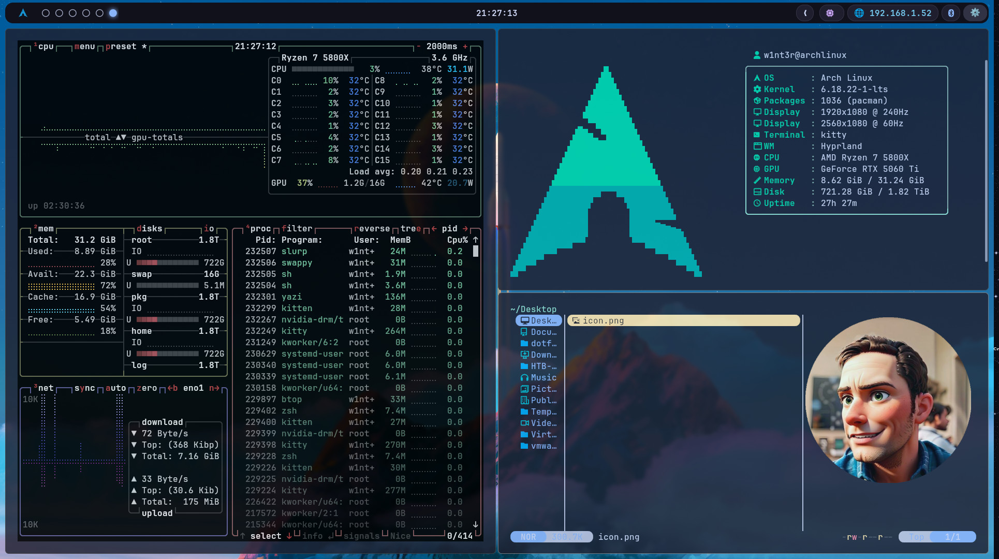

# 🌌 Dotfiles | Arch Linux + Hyprland

Welcome to my personal configuration repository. This setup is built for speed, aesthetics, and productivity, centered around **Hyprland** and themed with **Catppuccin Mocha**.



## 📦 Package Overview

This repository uses [GNU Stow](https://www.gnu.org/software/stow/) to manage configurations. Each directory corresponds to a specific application or system component.

| Package | Description | Key Features |
| :--- | :--- | :--- |
| [**Hyprland**](./hypr) | Dynamic tiling Wayland compositor | Smooth animations, custom keybinds, and workspace management. |
| [**Waybar**](./waybar) | Highly customizable status bar | System monitors (CPU, RAM, Battery), network status, and media control. |
| [**Rofi**](./rofi) | Application launcher & menu | Styled with Wayland support (lbonn-rofi) for launching apps and custom menus. |
| [**Kitty**](./kitty) | GPU-accelerated terminal | Fast, supports ligatures, and handles images in the terminal. |
| [**Zsh**](./zsh) | Primary shell configuration | Optimized with autosuggestions, syntax highlighting, and custom aliases. |
| [**Starship**](./starship) | Cross-shell prompt | Minimalist, fast, and informative prompt showing git status, runtime, etc. |
| [**Yazi**](./yazi) | Terminal file manager | Blazing fast, written in Rust, with image preview support. |
| [**Btop**](./btop) | Resource monitor | Modern alternative to top/htop with a sleek interface. |
| [**SwayNC**](./swaync) | Notification Center | GTK-based notification daemon with a control center (Do Not Disturb, etc.). |
| [**Dunst**](./dunst) | Notification daemon | Lightweight and highly configurable notification daemon. |
| [**Eww**](./eww) | ElKowars Wacky Widgets | Custom desktop widgets (calendars, control panels). |
| [**Cava**](./cava) | Audio visualizer | Bar-based audio visualizer for the terminal. |
| [**Gtk**](./gtk) | Visual themes | Configuration for Catppuccin Mocha themes and icons. |
| [**Wallpapers**](./wallpapers) | Desktop backgrounds | A curated collection of wallpapers sourced from [Wallhaven.cc](https://wallhaven.cc/). |

---

## 🛠️ System Components

### Window Management
- **WM:** Hyprland
- **Locker:** Hyprlock
- **Wallpaper:** Hyprpaper
- **Compositor:** Built-in Hyprland

### Appearance
- **Theme:** Catppuccin Mocha
- **Fonts:** JetBrainsMono Nerd Font, Iosevka, Hack
- **Notifications:** Sway Notification Center (SwayNC)

---

## 🚀 Getting Started

### 1. Prerequisites
Ensure you have the base dependencies installed. You can find the full lists here:
- [Official Repo Packages](packages-repo.txt)
- [AUR Packages](packages-aur.txt)

### 2. Installation
On a fresh Arch base install (made with `archinstall`), log in as your user and run:

```bash
git clone https://github.com/FerTV/dotfiles.git ~/dotfiles
cd ~/dotfiles
./install.sh          # add --dev for Podman + QEMU/libvirt
```

The script installs the packages, the NVIDIA driver, yay and the AUR packages, sets up GRUB for dual boot with Windows, enables ly, and links every config with Stow.

To link the configs by hand, stow each package (not `.`, and not `wallpapers`):

```bash
stow btop cava dunst eww gtk hypr kitty rofi starship swaync waybar yazi zsh
mkdir -p ~/Pictures/wallpapers && cp wallpapers/* ~/Pictures/wallpapers/
```

### 3. Fonts
This setup relies heavily on **Nerd Fonts**. Make sure to install them for the icons to render correctly.

---

## 📜 License
This project is open-source. Feel free to use and modify it for your own setup!
